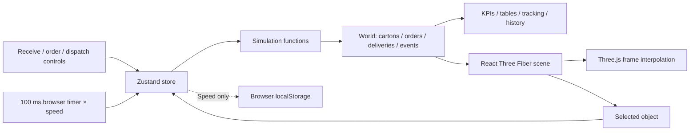
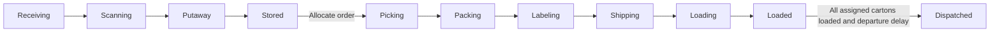

# CRM WMS — Interactive Warehouse Digital Twin

CRM WMS is a React application for exploring warehouse operations through an interactive isometric 3D digital twin. The interface retains its **Forma** branding. Cartons, inventory allocation, order stages, event histories, and dashboard totals use the same simulation state.

This is a browser-local logistics demonstration, not a production WMS or customer relationship management platform. It has no backend, database, authentication, customer contact module, or real warehouse integration.

## Contents

- [Features](#features)
- [Technology stack](#technology-stack)
- [Architecture](#architecture)
- [Installation](#installation)
- [Docker deployment](#docker-deployment)
- [Usage](#usage)
- [Development and testing](#development-and-testing)
- [Troubleshooting](#troubleshooting)
- [Roadmap](#roadmap)
- [License](#license)

## Features

| Capability | Status | Actual implementation |
| --- | --- | --- |
| 3D warehouse | Implemented | Orthographic camera, low-poly racks, conveyor, scanner, packing tables, loading docks, cartons, workers, forklifts, and trucks. Orbit, zoom, pan, reset, selected-carton focus, and zone views. |
| Carton movement and tracking | Implemented | Individual IDs, SKUs, weights, dimensions, allocation, waypoint routes, stages, and history. Search a full carton ID and highlight/focus it. |
| Inventory | Implemented | Three seeded SKUs, available-stock counts, allocation checks, bin assignments, an inventory table, and a nominal 216-carton receiving capacity. |
| Inbound | Implemented | Select SKU and quantity, create a delivery, then simulate receiving, scanning, putaway, and storage. |
| Picking and packing | Implemented | Single-SKU orders allocate specific available cartons and route them through picking, packing, labeling, and shipping. |
| Loading and dispatch | Implemented | Departure waits until all assigned cartons are loaded. Automatic dispatch is enabled by default; Manage dispatch configures dock and vehicle. |
| Dashboard | Implemented | State-derived available inventory, active orders, moving cartons, dispatched orders, utilization, pipeline counts, and simulated cartons/hour. “Today” means the current session. |
| Simulation controls | Implemented | Pause/resume; 1×, 2×, 5×, 10×; reset; entity visibility toggles; busy-day generation. |
| Busy-day generation | Partial | Attempts to add 100 inbound cartons and 20 two-carton orders. Capacity or stock shortages may stop generation after partial work; reset first for a predictable demo. |
| Clickable resource inspection | Partial | Racks, conveyors, workers, forklifts, and trucks expose simplified summaries, not a full resource ledger. |
| Vehicle and worker animation | Partial | Motion follows relevant processing stages/missions and shipment timing. No stable fleet reservation, realistic lifting/handoffs, door articulation, or comprehensive vehicle collision handling. |
| Conveyor/queues | Partial | Waypoint motion, processing delays, basic carton spacing checks, time-driven rollers, and a scanner indicator. Not a physics engine or complete workstation reservation system. |
| Navigation and analytics | Partial | Existing state tables and stage totals; several screens reuse order tables. No advanced reporting or separate backend modules. |
| Responsive layout | Partial | Sidebar and panels adapt to smaller screens. Mobile still renders 3D; no dedicated lightweight 2D mode. |
| Persistence | Partial | Only playback speed persists in browser localStorage. Reload resets all operational data. |
| Backend, APIs, database, authentication, real WMS integration | Planned | Not implemented or required to run this application. |

The demo seeds 72 stored cartons, nine inbound cartons, and three orders, then advances 13 simulated seconds before displaying the world. Initial figures already reflect that activity.

## Technology stack

**npm** is the package manager. The committed `package-lock.json` (v3) is authoritative for the complete dependency graph. Direct dependencies resolved in that lockfile:

| Purpose | Libraries and resolved versions |
| --- | --- |
| UI | React 19.3.1, React DOM 19.3.1 |
| 3D | Three.js 0.180.0, @react-three/fiber 9.8.2, @react-three/drei 10.7.9 |
| State | Zustand 5.0.16 |
| Styles | Tailwind CSS 4.3.3, @tailwindcss/vite 4.3.3, custom responsive CSS |
| Animation/icons | Framer Motion 12.43.0, Lucide React 0.468.0 |
| UI composition | @radix-ui/react-slot 1.5.0, clsx 2.1.1, tailwind-merge 3.7.0 |
| Build/development | Vite 6.4.5, @vitejs/plugin-react 4.7.0, TypeScript 5.7.3, tsx 4.23.15 |
| Type declarations | @types/node 22.20.5, @types/react 19.3.0, @types/react-dom 19.3.0, @types/three 0.180.0 |
| Tests | Node's built-in test runner and strict assertions, invoked through tsx |
| Containers | Node 22 Alpine build stage, Nginx stable Alpine runtime, Docker Compose v2 |

There is no Next.js, server framework, ORM, or database package. The Button wrapper uses Radix Slot directly; there is no generated shadcn/ui component collection. Container tags track release lines; pin image digests if immutable infrastructure builds are needed.

## Architecture



### Project structure

```text
crm-wms-project/
├── .dockerignore
├── .env.example
├── .gitignore
├── .openai/
│   └── hosting.json          # Existing optional Sites deployment identity
├── Dockerfile
├── compose.yaml
├── docker/
│   └── nginx.conf           # Static HTTP server, SPA fallback, health endpoint
├── index.html
├── package.json
├── package-lock.json
├── README.md
├── VERIFICATION.md          # Check results and remaining host blockers
├── src/
│   ├── main.tsx            # UI, navigation, operations, KPI calculations
│   ├── WarehouseScene.tsx  # Geometry, cameras, object selection, rendering
│   ├── simulation.ts      # Types, engine, seeded world, Zustand store
│   ├── simulation.test.ts # Four simulation regression/acceptance tests
│   └── style.css          # Tailwind import and responsive application CSS
├── tsconfig.json
└── vite.config.ts
```

`node_modules/`, `dist/`, `outputs/`, logs, and TypeScript build metadata are generated and ignored. `.openai/hosting.json` contains the existing Site identifier, not a credential; it is unnecessary for local deployment and excluded from Docker. A fork must not reuse that identity to publish over the original Site.

### Simulation model

`simulation.ts` defines `World`, `Carton`, `Order`, `Inbound`, and `Event`. Exported `initialWorld()`, `receive()`, `createOrder()`, `dispatch()`, and `advance()` own operations independently of rendering. The Zustand wrapper in the same module clones world state on ticks/actions and exposes controls.

`main.tsx` calls `tick(0.1)` every 100 ms. Playback speed scales simulated time. This is deterministic state progression for the same actions and increments, not a wall-clock service: browser background-tab throttling can slow it down. `advance()` handles routes, delays, basic spacing checks, stage transitions, and completion events. The activity feed retains the latest 180 events; individual carton and order histories remain in memory for the session.



`WarehouseScene.tsx` reads that world and uses `useFrame` for visual interpolation. No business operation is inferred from pixels. Vehicle and resource modeling is simpler than the carton state machine.

### Server, APIs, and data

- There is **no application backend or API**. Warehouse operations execute in the browser.
- There is **no database**, migration tool, server-side inventory, or shared session.
- Only playback speed uses localStorage, under `forma-speed`, scoped to the browser origin.
- Docker's Nginx serves static `dist/` assets and `GET /healthz`, returning plain `ok`. This checks HTTP availability, not WebGL or simulation correctness.
- Different browsers/tabs run independent simulations. Reloading recreates demo data.
- Rendering runs on the visitor's GPU. The container requires no GPU or display server.

## Installation

### Prerequisites

- Node.js **22 LTS** and npm (the Docker build also uses Node 22).
- Git and permission to access the repository.
- A current WebGL-capable browser, preferably with hardware acceleration enabled.

```bash
git clone https://github.com/Hamza-NAHI/crm-wms-project.git
cd crm-wms-project
npm ci
npm run dev
```

Open Vite's printed Local URL, normally **http://127.0.0.1:5173/**. Vite may select another port if busy. The existing development script binds to loopback.

### Configuration

No environment file, secret, API key, or database URL is required. The application does not read `import.meta.env` or `process.env`. `.env.example` documents only the optional Compose host-port setting; it is not a browser configuration file.

### Production build and preview

```bash
npm run typecheck
npm test
npm run build
npm run preview
```

Build runs `tsc -b && vite build` and produces `dist/`. Preview normally serves **http://127.0.0.1:4173/**; use the printed URL. Vite preview is for local verification. Docker uses Nginx instead of a development/preview server.

## Docker deployment

### Prerequisites

Use Docker Engine with Compose v2, or Docker Desktop in **Linux container mode**. On Windows, its Linux engine/WSL2 backend must be running.

```bash
docker version
docker compose version
```

`docker version` must display both client and server details. Host Node/npm are unnecessary for this path.

### Start

From the repository root:

```bash
docker compose up --build -d
docker compose ps
```

Open **http://localhost:3000/**. The only service is `web`. Host port 3000 maps to Nginx port 8080, bound to **127.0.0.1** for local access. There are no backend/database services or volumes.

The multi-stage build caches locked dependency installation before copying source. Only built static assets and Nginx configuration enter the runtime image. The runtime runs as the `nginx` user, with a read-only root filesystem, writable bounded `/tmp`, dropped capabilities, no privilege escalation, a health check, and graceful shutdown. `restart: unless-stopped` restarts failures but honors an explicit stop. A health status alone does not restart an unhealthy process.

To build/run without Compose:

```bash
docker build -t crm-wms:local .
docker run --rm -p 127.0.0.1:3000:8080 crm-wms:local
```

Standalone execution also uses the image's non-root user and health check; Compose supplies the additional filesystem/capability restrictions.

### Logs, health, stop, restart

```bash
docker compose logs -f
docker compose logs --tail=100 web
docker compose exec web nginx -t
docker compose exec web wget -q -O - http://127.0.0.1:8080/healthz
docker compose restart web
docker compose stop
docker compose start
docker compose down
```

Ctrl+C exits log following without stopping the container. `down` removes the project container/network, retaining the image. No database volumes exist. Health begins as `starting` and should become `healthy` after the configured check interval.

Rebuild after source edits:

```bash
docker compose up --build -d
```

For a clean dependency/build-layer rebuild:

```bash
docker compose build --no-cache
docker compose up -d
```

### Change port

Copy the optional example:

```bash
# macOS / Linux
cp .env.example .env
```

```powershell
# PowerShell
Copy-Item .env.example .env
```

Edit `.env` to `CRM_WMS_PORT=3001`, then run `docker compose up -d`. Open http://localhost:3001/. Port-only changes need container recreation, not an image rebuild. `docker compose config` shows the resolved mapping. `.env` is ignored by Git and excluded from the Docker context.

### Reset local demo data

Click **Reset simulation**, or **Simulation settings → Reset simulation**. Reloading the page also recreates the seeded world. Reset preserves speed; select **1×** to restore normal playback. Remove `forma-speed` from browser developer tools' localStorage if necessary. Different hostnames/ports have independent storage.

Restarting a container does not reset JavaScript already running in an open page. There is no database reset command or volume to delete.

## Usage

### Explore

Open **Live Warehouse**. Drag to rotate, scroll to zoom, right-drag to pan. Use Overview, Receiving, Storage, Packing, and Shipping for zone views. Click objects for summaries; collapse the feed to enlarge the scene. Reset view restores the camera.

### Receive inventory

Choose **Receive shipment**, select `SKU-1042`, `SKU-2088`, or `SKU-3015`, and enter a quantity accepted by the form (1–100). A delivery and carton IDs are created, then receiving/scanning/putaway delays progress them to available stored inventory. Capacity overflow is rejected. This is simulated stock, not an external import.

### Create an order and verify fulfillment

1. Click **Create order** and choose a SKU with at least five available cartons.
2. Enter **5** and submit. Specific cartons are allocated, reducing available inventory.
3. Select **10×** if desired.
4. Open **Orders** in the operations feed and select the new order.
5. Observe Picking → Packing → Loading → Departing → Dispatched.
6. Choose **Activity** to review its history; click its carton IDs to inspect per-carton details.

The engine prevents double allocation and rejects insufficient available stock. Each order currently contains one SKU; multi-line orders are planned.

### Track cartons

Search a full ID such as **CTN-1010** and press Enter or the arrow button. Search ignores case. The scene focuses the selected carton and the panel shows its details/history. Loaded and dispatched cartons remain in tracking data but are hidden as warehouse meshes.

### Dispatch

Click **Manage dispatch**, select an active order, choose Dock 1/2, and enter a vehicle reference. Scheduling waits for every allocated carton to load; it never forces an incomplete departure. Automatic dispatch is already enabled for new orders, so this step is optional.

### Simulation controls

Pause/resume and choose 1×/2×/5×/10×. Open **Simulation settings** for workers/cartons/pallets/vehicles visibility; hiding entities does not remove their state. **Busy shipping day** attempts 100 inbound cartons plus 20 orders; reset first if capacity or stock is low. It is not transactional and can retain partially generated work on failure. Large workloads/high speeds can reduce performance.

Inventory, Orders, Inbound Operations, and Analytics expose tables/stage counts below the scene; scroll to see them.

## Development and testing

| Command | Purpose |
| --- | --- |
| `npm ci` | Reproducible clean installation from the lockfile |
| `npm run dev` | Vite development server/hot reload |
| `npm run typecheck` | TypeScript checking without emitting output |
| `npm test` | Four simulation tests through tsx and node:test |
| `npm run build` | Type check and optimized production bundle |
| `npm run preview` | Serve compiled assets locally |
| `docker compose config` | Validate/resolve Compose configuration |
| `npm ls --depth=0` | List installed direct dependencies |

There is **no lint script or linter configuration**; linting must not be reported as passed.

See [VERIFICATION.md](VERIFICATION.md) for the preparation check results and Docker host-engine blocker. A valid Compose configuration is not evidence of a successful image build or running container.

The existing tests cover five-carton fulfillment through dispatch, prevention of over-allocation/double allocation, receiving completion/capacity checks, and bounded continuous route steps. They stub localStorage because importing `simulation.ts` also initializes the browser-oriented Zustand store. They do not exercise WebGL, cameras, responsive layouts, physical realism, Docker startup, or Nginx.

### Browser smoke test

After starting Docker or production preview:

1. Confirm dashboard and 3D scene render; inspect browser console errors.
2. Pause/resume, change zones, reset the camera, and collapse the panel.
3. Create a five-carton order and follow its IDs/history to dispatch.
4. Receive stock and observe its completion.
5. Search a valid and a nonexistent carton ID; inspect feedback.
6. Check a narrower viewport.

### Debugging and extension

- Keep business rules in `simulation.ts`, visual geometry/cameras in `WarehouseScene.tsx`, and UI interactions in `main.tsx`.
- Inspect event histories to locate the last completed stage. Use browser developer tools for JavaScript/WebGL and storage issues.
- The current main bundle is large; Vite's size warning is known. Code splitting, instancing, and profiling remain future work.
- No future client-visible Vite variable should contain secrets: browser bundles are public to visitors.

## Troubleshooting

| Problem | Resolution |
| --- | --- |
| Missing `dockerDesktopLinuxEngine` pipe / cannot connect to Docker | Start Docker Desktop, wait for its Linux engine, and check WSL2/virtualization prerequisites. The CLI alone is insufficient. `docker version` must show a server. |
| Cannot download base images or npm packages | Check Docker daemon network/proxy/registry connectivity. Public base images and npm packages need no personal credentials in the Dockerfile. |
| Port 3000 occupied | Stop the conflicting service or set `CRM_WMS_PORT=3001` in `.env`, recreate the service, and use the new URL. |
| Container running but page unavailable | Check `docker compose ps`, logs, `/healthz`, and host mapping. Use HTTP and Linux container mode. |
| Unhealthy container | Check logs, run `nginx -t` inside the service, confirm port 8080 and writable `/tmp`. |
| Old page after rebuilding | Run `docker compose up --build -d`, then refresh. HTML revalidates; fingerprinted assets are cached. |
| npm/native optional dependency failures | Use Node 22 and rerun `npm ci` with the committed lockfile. Never copy Windows node_modules into the Linux image; Docker excludes them. |
| Blank/slow WebGL scene | Enable hardware acceleration, update browser/graphics drivers, inspect browser console. Rendering uses the browser GPU, not a container GPU. The error boundary cannot recover every graphics/context failure. |
| Simulation slows in background | Browser timers are throttled; return to the active tab. No server clock exists. |
| Insufficient stock | Lower quantity, choose another SKU, finish receiving, or reset. Only stored/unallocated cartons can be assigned. |
| Busy-day workload partially added | Capacity/stock checks can stop generation midway. Reset before retrying. |
| Selected carton has no visible mesh | Loaded/dispatched cartons are retained in records but excluded from active warehouse meshes. |
| Playback fast after reload | Select 1×; speed persists in localStorage under `forma-speed`. |
| Database configuration/migration requested | None exists or is needed. Do not add a database service for this frontend. |
| Git clone denied | Authenticate Git/SSH and verify repository permissions. Visibility and access are configured on GitHub, not by the application. |

## Roadmap

Planned separately from implemented features:

- Backend APIs, durable inventory/history, authentication and roles, real WMS integration.
- Customer/CRM records and multi-line orders.
- Stable worker/forklift resource assignment, dock reservation, improved workstation queues.
- More realistic lifting, handoffs, turning, truck doors, and collision handling.
- Atomic scenario generation, stronger input validation, bin/capacity modeling.
- Instanced rendering, code splitting, performance profiling for long-running workloads.
- Browser end-to-end tests, accessibility audits, and continuous integration.
- Dedicated mobile 2D mode, saved scenarios, richer analytics.

## License

**No project license has been granted in this repository.** No open-source license is implied. Obtain the owner's permission before copying, modifying, distributing, or using the project beyond applicable legal rights. Third-party dependencies retain their own licenses; consult their notices separately.
